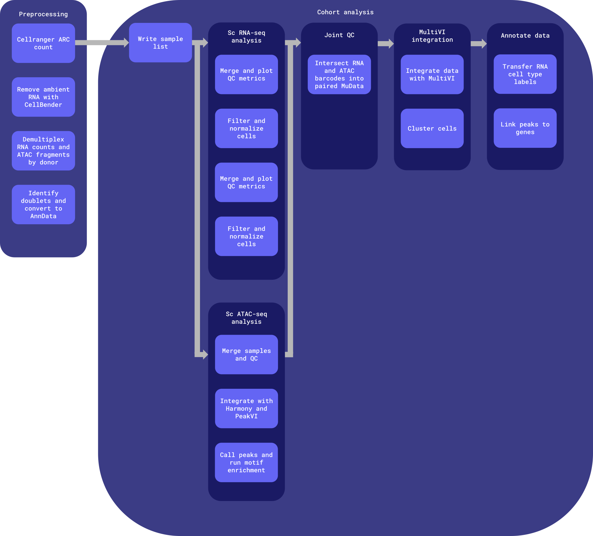

# sc-multiome-wf

Repo for testing and developing a common postmortem-derived brain sequencing (PMDBS) workflow harmonized across ASAP with human single-cell/single-nucleus multiome (paired gene expression and chromatin accessibility) sequencing data.

Common workflows, tasks, utility scripts, and docker images reused across harmonized ASAP workflows are defined in [the wf-common repository](https://github.com/ASAP-CRN/wf-common). The RNA and ATAC cohort analyses are imported from [the sc-rnaseq-wf repository](https://github.com/ASAP-CRN/sc-rnaseq-wf) and [the sc-atacseq-wf repository](https://github.com/ASAP-CRN/sc-atacseq-wf), which are included as submodules.


# Table of contents

- [Workflows](#workflows)
- [Inputs](#inputs)
- [Outputs](#outputs)
    - [Output structure](#output-structure)
- [Docker images](#docker-images)


# Workflows

Worfklows are defined in [the `workflows` directory](workflows). The python scripts which process the data at each stage can be found in [the docker/sc_multiome_tools/scripts directory](docker/sc_multiome_tools/scripts).

Workflow name: `pmdbs_sc_multiome`



**Entrypoint**: [workflows/main.wdl](workflows/main.wdl)

**Input template**: [workflows/inputs.json](workflows/inputs.json)

The workflow is broken up into two main chunks:

1. [Preprocessing](#preprocessing)
2. [Cohort analysis](#cohort-analysis)

## Preprocessing

Run once per pool (or per sample, if not multiplexed); only rerun when the preprocessing workflow version is updated. Preprocessing outputs are stored in the originating team's raw and staging data buckets.

1. **Cell Ranger ARC count**: Gene expression (GEX) and ATAC libraries for each pool are processed together with `cellranger-arc count`.
2. **Remove technical artifacts**: Ambient RNA is removed from the GEX counts with CellBender.
3. **Demultiplex**: For multiplexed pools, cells are assigned to donors using the provided Vireo assignment files. RNA counts are split per donor, and ATAC fragments are split per donor with `scatac_fragment_tools` (see [Demultiplexing](#demultiplexing)).
4. **Convert to AnnData**: RNA counts are converted to AnnData objects with scanpy (including Scrublet doublet scores), and ATAC fragments are converted to AnnData objects with SnapATAC2. One object is produced per demultiplexed sample, or per sample if not multiplexed.

Each step is skipped if its outputs already exist for that pool/sample and task version.

## Cohort analysis

Run once per team (all samples from a single team) if `project.run_project_cohort_analysis` is set to `true`, and once for the whole cohort (all samples from all teams) if `run_cross_team_cohort_analysis` is set to `true`. This can be rerun using different sample subsets; including additional samples requires this entire analysis to be rerun. Intermediate files from previous runs are not reused and are stored in timestamped directories.

1. **scRNA-seq cohort analysis**: The [sc-rnaseq-wf cohort analysis](https://github.com/ASAP-CRN/sc-rnaseq-wf) is run on the RNA AnnData objects (QC, filtering, MapMyCells cell type assignment, normalization, scVI/scANVI integration, and clustering).
2. **scATAC-seq cohort analysis**: The [sc-atacseq-wf cohort analysis](https://github.com/ASAP-CRN/sc-atacseq-wf) is run on the ATAC AnnData objects (QC, Harmony and PeakVI integration, peak calling, and motif enrichment).
3. **Joint QC**: Filtered RNA and ATAC barcodes are intersected into a paired multiome MuData object. The run fails if the fraction of shared barcodes is below `min_overlap_frac`, as this likely indicates a barcode key mismatch.
4. **MultiVI integration**: A MultiVI model is trained on the paired data to learn a joint, batch-corrected latent representation, which is then clustered with Leiden.
5. **Annotate data**: RNA-derived cell type labels are transferred onto the MuData object by barcode (paired cells absent from the labeled RNA object are marked 'Unknown'), and per-sample Cell Ranger ARC peak-gene feature linkages are added.

# Inputs

An input template file can be found at [workflows/inputs.json](workflows/inputs.json).

| Type | Name | Modality | Description |
| :- | :- | :- | :- |
| String | cohort_id | All | Name of the cohort; used to name output files during cross-team cohort analysis. |
| Array[[Project](#project)] | projects | All | The project ID, set of samples and their associated reads and metadata, output bucket locations, and whether or not to run project-level cohort analysis. |
| File? | kamath_post_qc_adata_object | sc RNA-seq | Downsampled and QC-filtered Kamath et al. 2022 AnnData object; its dopaminergic neurons are spiked into the cohort's MMC-labeled RNA AnnData object before scVI/scANVI so scANVI can learn DA subtype labels. Used by sc RNA-seq cohort analysis only; human only. If not provided, no Kamath cells are spiked in. |
| File? | siletti_post_qc_adata_object | sc RNA-seq | Downsampled and QC-filtered Siletti et al. 2023 midbrain AnnData object; its cells are spiked in unlabeled, with Allen ground truth labels kept to benchmark scANVI predictions (per-label F1). Used by sc RNA-seq cohort analysis only; human only, and only meaningful when mmc_taxonomy is 'Siletti'. If not provided, no Siletti cells are spiked in. |
| File | cellranger_arc_reference_data | sc Multiome | Cell Ranger ARC reference data; see https://www.10xgenomics.com/support/software/cell-ranger-arc/downloads. |
| File | cellranger_atac_reference_chrom_sizes | sc ATAC-seq | Chromosome sizes file (.chrom.sizes or .fa.fai) from the Cell Ranger ARC reference, used to validate fragment coordinates when splitting fragments by donor; see [Generating chromosome sizes file](#demultiplexing). |
| Float? | cellbender_fpr | sc RNA-seq | Cellbender false positive rate for signal removal. [0.0] |
| Array[File]? | vireo_assignment_files | sc RNA-seq, sc ATAC-seq | Vireo donor assignment CSVs with columns: donor_id, sample (pool), raw_bc. Required for multiplexed pools; must cover all donors in each pool. |
| Int? | n_cells | sc RNA-seq | Number of cells to keep. Cells are drawn uniformly at random without replacement for downsampling. Default is to keep all cells. |
| Int? | pct_counts_mt_max | sc RNA-seq | Maximum percentage of mitochondrial gene counts allowed per cell. [10] |
| Float? | doublet_score_max | sc RNA-seq | Maximum doublet detection score threshold. [0.2] |
| Array[Int]? | total_counts_limits | sc RNA-seq | Absolute minimum and maximum total UMI (unique molecular identifier) counts per cell; applied on top of the MAD-based thresholds. [500, 150000] |
| Array[Int]? | n_genes_by_counts_limits | sc RNA-seq | Absolute minimum and maximum number of genes detected per cell (genes with at least one count); applied on top of the MAD-based thresholds. [300, 15000] |
| Float? | n_mads_lower | sc RNA-seq | Number of median absolute deviations below the per-sample median allowed for total UMI counts and number of genes detected per cell. [3] |
| Float? | n_mads_upper | sc RNA-seq | Number of median absolute deviations above the per-sample median allowed for total UMI counts and number of genes detected per cell. [5] |
| String | mmc_taxonomy | sc RNA-seq, sc ATAC-seq | Cell type taxonomy of the precomputed stats reference; appended to MMC output filenames. Must match allen_brain_mmc_precomputed_stats_h5. Options are 'SEAAD' (human) or 'Siletti' (human). |
| File | allen_brain_mmc_precomputed_stats_h5 | sc RNA-seq, sc ATAC-seq | A precomputed statistics file from the Allen Brain Cell Atlas containing reference statistics (the average gene expression profile per cell type cluster and cell type taxonomy). |
| Int? | norm_target_sum | sc RNA-seq | The total count value that each cell will be normalized to. [10000] |
| Int? | n_top_genes | sc RNA-seq, sc ATAC-seq | Number of HVG genes to keep. [3000] |
| Int? | n_comps | sc RNA-seq, sc ATAC-seq | Number of principal components to compute. [30] |
| String? | batch_key | sc RNA-seq, sc ATAC-seq, sc Multiome | Key in AnnData/MuData object for batch information. ['batch_id'] |
| String? | scvi_latent_key | sc RNA-seq | Latent key to save the scVI latent to. ['X_scVI'] |
| String? | scanvi_latent_key | sc RNA-seq | Latent key to save the scANVI latent to. ['X_scANVI'] |
| String? | scanvi_predictions_key | sc RNA-seq, sc Multiome | scANVI cell type predictions column name. ['C_scANVI'] |
| Int? | n_neighbors | sc RNA-seq, sc Multiome | The size of local neighborhood (in terms of number of neighboring data points) used for manifold approximation; used for RNA and MultiVI clustering. [15] |
| Array[Float]? | leiden_res | sc RNA-seq, sc Multiome | Leiden resolutions which are the parameter values controlling the coarseness of the clustering; used for RNA and MultiVI clustering. [0.2, 0.5, 1.0] |
| Array[String]? | rna_groups | sc RNA-seq | RNA groups to produce umap plots for. ['sample', 'batch_id', 'cell_type', 'leiden_res_0.20', 'leiden_res_0.50', 'leiden_res_1.0'] |
| Array[String]? | rna_features | sc RNA-seq | RNA features to produce umap plots for. ['n_genes_by_counts', 'total_counts', 'pct_counts_mt', 'pct_counts_rb', 'doublet_score', 'S_score', 'G2M_score'] |
| String? | peakvi_latent_key | sc ATAC-seq | Latent key to save the PeakVI latent to. ['X_peakVI'] |
| Int? | peakvi_max_epochs | sc ATAC-seq | The maximum number of full passes through the training data during PeakVI model training. If the model converges early, training will halt before this limit is reached. [300] |
| Int? | peakvi_n_hidden | sc ATAC-seq | Number of nodes per hidden layer for PeakVI. [128] |
| Int? | peakvi_batch_size | sc ATAC-seq | Training batch size for PeakVI. [128] |
| Array[String]? | atac_groups | sc ATAC-seq | ATAC groups to produce umap plots for. ['sample', 'batch', 'team', 'dataset', 'batch_id', 'leiden'] |
| Array[String]? | atac_features | sc ATAC-seq | ATAC features to produce umap plots for. ['n_fragment', 'tsse', 'frac_dup', 'frac_mito', 'doublet_score', 'doublet_probability'] |
| Float? | min_overlap_frac | sc Multiome | Minimum fraction of the smaller modality's barcodes that must be shared between the filtered RNA and ATAC objects in joint QC; below this the run fails as a likely barcode key mismatch. [0.5] |
| String? | multivi_latent_key | sc Multiome | Latent key to save the MultiVI latent to. ['X_multiVI'] |
| Int? | multivi_max_epochs | sc Multiome | The maximum number of full passes through the training data during MultiVI model training. If the model converges early, training will halt before this limit is reached. [300] |
| Int? | multivi_n_hidden | sc Multiome | Number of nodes per hidden layer for MultiVI. [128] |
| Int? | multivi_batch_size | sc Multiome | Training batch size for MultiVI. [128] |
| Boolean? | peak_gene_only | sc Multiome | Keep only peak-gene and gene-peak feature linkages (drop peak-peak). [true] |
| Float? | min_linkage_corr | sc Multiome | Minimum absolute feature linkage correlation to retain. [0.1] |
| Float? | min_linkage_sig | sc Multiome | Minimum feature linkage significance to retain. [0.0] |
| Boolean? | run_cross_team_cohort_analysis | All | Whether to run downstream harmonization steps on all samples across projects. If set to false, only preprocessing steps (Cell Ranger ARC and generating the initial adata object(s)) will run for samples. [false] |
| String | cohort_raw_data_bucket | All | Bucket to upload cross-team cohort intermediate files to. |
| Array[String] | cohort_staging_data_buckets | All | Buckets to upload cross-team cohort analysis outputs to. |
| String | container_registry | All | Container registry where workflow Docker images are hosted. |
| String? | zones | All | GCP zones where compute will take place. ['us-central1-c us-central1-f'] |

## Structs

### Project

| Type | Name | Description |
| :- | :- | :- |
| String | asap_team_id | ASAP-generated unique identifier for team; used for naming output files. |
| String | asap_dataset_id | ASAP-generated unique identifier for dataset; used for metadata. |
| String | asap_dataset_doi_url | ASAP-generated Zenodo DOI URL referencing the dataset. |
| Array[[Sample](#sample)] | samples | The set of samples (or pools, if multiplexed) associated with this project. |
| Boolean | run_project_cohort_analysis | Whether or not to run cohort analysis within the project. |
| String | raw_data_bucket | Raw data bucket; intermediate output files that are not final workflow outputs are stored here. |
| Array[String] | staging_data_buckets | Staging data buckets; final project-level outputs are stored here. |

### Sample

A sample, or a pool of samples if `multiplexed_samples` is not empty.

| Type | Name | Description |
| :- | :- | :- |
| String | sample_id | ASAP-generated unique identifier combined with the replicate for the sample within the project. Treated as the pool ID when multiplexed; used for naming output files. If treated as pool ID, the optional batch, sex, brain_region_level_1, brain_region_level_2, and brain_region_level_3 can be left empty because this information can be inputted in the [MuxSample](#muxsample) struct. |
| String? | batch | The sample's batch. |
| String? | sex | The sample's sex. |
| String? | brain_region_level_1 | Abbreviation of most granular anatomical region (Level 1). |
| String? | brain_region_level_2 | Abbreviation of intermediate level anatomical region (Level 2). |
| String? | brain_region_level_3 | Abbreviation of coarse level anatomical region (Level 3). |
| Array[File]+ | fastq_R1s | Paths to the sample's read 1 FASTQ files. |
| Array[File]+ | fastq_R2s | Paths to the sample's read 2 FASTQ files. |
| Array[File] | fastq_I1s | Paths to the sample's index 1 FASTQ files; may be empty. |
| Array[File] | fastq_I2s | Paths to the sample's index 2 FASTQ files; may be empty. |
| Array[[MuxSample](#muxsample)] | multiplexed_samples | The set of samples pooled together; empty if the sample is not multiplexed. |

All GEX and ATAC FASTQs for a sample/pool are staged into a single directory for `cellranger-arc count`, which identifies each library and read type from the FASTQ filename. FASTQ basenames must therefore be unique and follow the 10x naming convention (e.g. `*_S1_L001_R1_001.fastq.gz`).

### MuxSample

| Type | Name | Description |
| :- | :- | :- |
| String | source_subject_id | CRN Team provided unique identifier for subject/donor; must match the `donor_id` in the Vireo assignment files. |
| String | asap_subject_id | ASAP-generated unique identifier for subject/donor; used for metadata. |
| String | sample_id | ASAP-generated unique identifier combined with the replicate for the sample within the project; must be unique within the pool. |
| String? | batch | The sample's batch. |
| String? | sex | The sample's sex. |
| String? | brain_region_level_1 | Abbreviation of most granular anatomical region (Level 1). |
| String? | brain_region_level_2 | Abbreviation of intermediate level anatomical region (Level 2). |
| String? | brain_region_level_3 | Abbreviation of coarse level anatomical region (Level 3). |

Every donor listed in a pool's `multiplexed_samples` must have cells assigned to that pool in the Vireo assignment files; otherwise demultiplexing for that pool will fail.

## Generating the inputs JSON

The inputs JSON may be generated manually, however when running a large number of samples, this can become unwieldly. The [`generate_inputs` utility script](https://github.com/ASAP-CRN/wf-common/blob/main/util/workflow_inputs/generate_inputs) may be used to automatically generate the inputs JSON (`inputs.{staging_env}.{cohort_dataset_id}.{date}.json`) and a sample list TSV (`{team_id}.{cohort_dataset_id}.sample_list.{date}.tsv`); same as the one generated in [the write_cohort_sample_list task](https://github.com/ASAP-CRN/wf-common/blob/main/wdl/tasks/write_cohort_sample_list.wdl)). The script requires the libraries outlined in [the requirements.txt file](https://github.com/ASAP-CRN/wf-common/blob/main/util/requirements.txt) and the following inputs:

- `project-tsv`: One or more project TSVs with one row per sample (per donor within a pool, if multiplexed). All samples from all projects may be included in the same project TSV, or multiple project TSVs may be provided. Rows sharing a `pool_id` are grouped into one pool; their FASTQs are combined.
    - `team_id`: A unique identifier for the team from which the sample(s) arose.
    - `ASAP_dataset_id`: A generated unique identifier for the dataset from which the sample(s) arose.
    - `pool_id`: Source identifier for the pool within the project.
    - `subject_id`: Source identifier for the subject/donor within the pool/project; used as `source_subject_id`.
    - `ASAP_subject_id`: A generated unique identifier for the subject/donor within the pool/project.
    - `ASAP_sample_id`: A generated unique identifier for the sample within the pool/project.
    - `batch`: The sample's batch.
    - `sex`: The sample's sex.
    - `region_level_1`: Abbreviation of most granular anatomical region (Level 1).
    - `region_level_2`: Abbreviation of intermediate level anatomical region (Level 2).
    - `region_level_3`: Abbreviation of coarse level anatomical region (Level 3).
    - `fastq_R1s`, `fastq_R2s`, `fastq_R3s`, `fastq_I1s`, `fastq_I2s`: Python list literals of the gs uris to the pool's GEX and ATAC FASTQs.
        - FASTQ locations may be generated e.g. by running `gcloud storage ls gs://fastq_bucket/some/path/**.fastq.gz >> fastq_locs.txt`.
    - `embargoed`: The internal QC/embargo status of dataset.
    - `dataset_id`: The dataset name used in bucket names (e.g. 'team-xxyy-pmdbs-sn-multimodal').
    - `source`: The source of dataset (e.g. 'pmdbs').
    - `assay`: The assay of dataset.
    - `dataset_doi_url`: Generated Zenodo DOI URL referencing the dataset.
- `inputs-template`: The inputs template JSON file into which the `projects` information derived from the `project-tsv` will be inserted. Must have a key ending in `*.projects`. Other default values filled out in the inputs template will be written to the output inputs.json file.
- `run-project-cohort-analysis`: Optionally run project-level cohort analysis for provided projects. This value will apply to all projects. [false]
- `workflow-name`: WDL workflow name (`sc_multiome_analysis`).
- `release-version`: CRN release version (e.g. 'v6.0.0').
- `cohort-dataset-id`: Dataset name in cohort bucket id (e.g. 'cohort-pmdbs-sc-multiome').

Example usage:

```bash
./wf-common/util/workflow_inputs/generate_inputs \
    --project-tsv metadata.tsv \
    --inputs-template workflows/inputs.json \
    --run-project-cohort-analysis \
    --workflow-name sc_multiome_analysis \
    --release-version v6.0.0 \
    --cohort-dataset-id cohort-pmdbs-sc-multiome
```

# Outputs

## Output structure

- `cohort_id`: either the `team_id` for project-level cohort analysis, or the `cohort_id` for the full cohort
- `workflow_run_timestamp`: format: `%Y-%m-%dT%H-%M-%SZ`
- `dataset_sample_id`: `${dataset_id}.${sample_id}` for preprocessing outputs generated per sample or pool; demultiplexed outputs are named `${dataset_id}.${sample_id}.${pool_id}`
- The list of samples used to generate the cohort analysis will be output alongside other cohort analysis outputs in the staging data bucket (`${cohort_id}.sample_list.tsv`)
- The `MANIFEST.tsv` file in the staging data bucket describes the file name, md5 hash, timestamp, workflow version, workflow name, and workflow release for the run used to generate each file in that directory

### Raw data (intermediate files and final outputs for all runs of the workflow)

The raw data bucket will contain *some* artifacts generated as part of workflow execution. Following successful workflow execution, the artifacts will also be copied into the staging bucket as final outputs.

In the workflow, task outputs are either specified as `String` (final outputs, which will be copied in order to live in raw data buckets and staging buckets) or `File` (intermediate outputs that are periodically cleaned up, which will live in the cromwell-output bucket). This was implemented to reduce storage costs.

```bash
asap-raw-{cohort,team-xxyy}-{source}-{modality_flavour}-{context}
└── workflow_execution
    └── pmdbs_sc_multiome
        ├── cohort_analysis
        │   ├── rna
        │   │   └── ${rna_cohort_analysis_workflow_version}
        │   │       └── ${workflow_run_timestamp}
        │   │           └── <scRNA-seq cohort outputs>
        │   ├── atac
        │   │   └── ${atac_cohort_analysis_workflow_version}
        │   │       └── ${workflow_run_timestamp}
        │   │           └── <scATAC-seq cohort outputs>
        │   └── multiome
        │       └── ${cohort_analysis_workflow_version}
        │           └── ${workflow_run_timestamp}
        │               └── <multiome cohort outputs>
        └── preprocess  // only produced in project raw data buckets, not in the full cohort bucket
            ├── multiome
            │   └── cellranger_arc
            │       └── ${cellranger_arc_task_version}
            │           └── <cellranger_arc_count output>
            ├── rna
            │   ├── remove_technical_artifacts
            │   │   └── ${cellbender_task_version}
            │   │       └── <rna_remove_technical_artifacts output>
            │   ├── split_demux_counts
            │   │   └── ${rna_demux_counts_task_version}
            │   │       └── <rna_demux_counts output>
            │   └── counts_to_adata
            │       └── ${rna_adata_task_version}
            │           └── <counts_to_adata output>
            └── atac
                ├── split_demux_fragments
                │   └── ${atac_demux_fragments_task_version}
                │       └── <split_demux_fragments output>
                └── fragments_to_adata
                    └── ${atac_adata_task_version}
                        └── <fragments_to_adata output>
```

### Staging data (intermediate workflow objects and final workflow outputs for the latest run of the workflow)

Following QC by researchers, the objects in the dev or uat bucket are synced into the curated data buckets, maintaining the same file structure. Curated data buckets are named `asap-curated-{cohort,team-xxyy}-{source}-{modality_flavour}-{context}` and `dataset_id` = `{cohort,team-xxyy}-{source}-{modality_flavour}-{context}`.

Data may be synced using [the `promote_staging_data` script](#promoting-staging-data).

The `rna` and `atac` directories contain the same outputs as the [sc-rnaseq-wf](https://github.com/ASAP-CRN/sc-rnaseq-wf#staging-data-intermediate-workflow-objects-and-final-workflow-outputs-for-the-latest-run-of-the-workflow) and [sc-atacseq-wf](https://github.com/ASAP-CRN/sc-atacseq-wf#staging-data-intermediate-workflow-objects-and-final-workflow-outputs-for-the-latest-run-of-the-workflow) workflows, respectively.

```bash
asap-dev-{cohort,team-xxyy}-{source}-{modality_flavour}-{context}
└── pmdbs_sc_multiome
    └── release
        └── ${crn_release_version}
            ├── cohort_analysis
            │   ├── rna
            │   │   └── <scRNA-seq cohort outputs; see sc-rnaseq-wf>
            │   ├── atac
            │   │   └── <scATAC-seq cohort outputs; see sc-atacseq-wf>
            │   └── multiome
            │       ├── ${cohort_id}.sample_list.tsv
            │       ├── ${cohort_id}.filtered.h5mu
            │       ├── ${cohort_id}.multivi_model.tar.gz
            │       ├── ${cohort_id}.multivi_umap.png
            │       ├── ${cohort_id}.final.h5mu
            │       ├── ${cohort_id}.feature_linkage_per_sample.csv
            │       ├── ${cohort_id}.final_metadata.csv
            │       └── MANIFEST.tsv
            ├── preprocess
            │   ├── multiome
            │   │   ├── ${dataset_id}.${poolA_id}.cellranger_arc_multiome_outputs.tar.gz
            │   │   ├── ${dataset_id}.${poolA_id}.raw_feature_bc_matrix.h5
            │   │   ├── ${dataset_id}.${poolA_id}.filtered_feature_bc_matrix.h5
            │   │   ├── ${dataset_id}.${poolA_id}.gex_molecule_info.h5
            │   │   ├── ${dataset_id}.${poolA_id}.summary.csv
            │   │   ├── ${dataset_id}.${poolA_id}.per_barcode_metrics.csv
            │   │   ├── ${dataset_id}.${poolA_id}.gex_possorted_bam.bam
            │   │   ├── ${dataset_id}.${poolA_id}.gex_possorted_bam.bam.bai
            │   │   ├── ${dataset_id}.${poolA_id}.atac_possorted_bam.bam
            │   │   ├── ${dataset_id}.${poolA_id}.atac_possorted_bam.bam.bai
            │   │   ├── ${dataset_id}.${poolA_id}.atac_fragments.tsv.gz
            │   │   ├── ${dataset_id}.${poolA_id}.atac_fragments.tsv.gz.tbi
            │   │   ├── ${dataset_id}.${poolA_id}.atac_peaks.bed
            │   │   ├── ${dataset_id}.${poolA_id}.atac_cut_sites.bigwig
            │   │   ├── ${dataset_id}.${poolA_id}.atac_peak_annotation.tsv
            │   │   ├── ${dataset_id}.${poolA_id}.feature_linkage.bedpe
            │   │   ├── ...
            │   │   └── MANIFEST.tsv
            │   ├── rna
            │   │   ├── ${dataset_id}.${poolA_id}.cellbender_report.html
            │   │   ├── ${dataset_id}.${poolA_id}.cellbender.h5
            │   │   ├── ${dataset_id}.${poolA_id}.cellbender_filtered.h5
            │   │   ├── ${dataset_id}.${poolA_id}.cellbender_cell_barcodes.csv
            │   │   ├── ${dataset_id}.${poolA_id}.cellbender.pdf
            │   │   ├── ${dataset_id}.${poolA_id}.cellbender.log
            │   │   ├── ${dataset_id}.${poolA_id}.cellbender_metrics.csv
            │   │   ├── ${dataset_id}.${poolA_id}.cellbend_posterior.h5
            │   │   ├── ${dataset_id}.${sampleA_id}.${poolA_id}.demux_counts.h5ad
            │   │   ├── ${dataset_id}.${sampleA_id}.${poolA_id}.cleaned_unfiltered.h5ad
            │   │   ├── ...
            │   │   ├── ${dataset_id}.${sampleN_id}.${poolA_id}.demux_counts.h5ad
            │   │   ├── ${dataset_id}.${sampleN_id}.${poolA_id}.cleaned_unfiltered.h5ad
            │   │   ├── ...
            │   │   └── MANIFEST.tsv
            │   └── atac
            │       ├── ${dataset_id}.${sampleA_id}.${poolA_id}.fragments.tsv.gz
            │       ├── ${dataset_id}.${sampleA_id}.${poolA_id}.cleaned_unfiltered.h5ad
            │       ├── ...
            │       ├── ${dataset_id}.${sampleN_id}.${poolA_id}.fragments.tsv.gz
            │       ├── ${dataset_id}.${sampleN_id}.${poolA_id}.cleaned_unfiltered.h5ad
            │       ├── ...
            │       └── MANIFEST.tsv
            ├── workflow_version # plain text file
            └── workflow_metadata
                └── ${timestamp}
                    ├── MANIFEST.tsv # combined
                    └── data_promotion_report.md
```

For samples that are not multiplexed, the demultiplexed files are not produced and the AnnData objects are named `${dataset_id}.${sample_id}.cleaned_unfiltered.h5ad`.

## Promoting staging data

The [`promote_staging_data` script](https://github.com/ASAP-CRN/wf-common/blob/main/util/promote_staging_data) can be used to promote staging data that has been approved to the curated data bucket for a team or set of teams.

This script compiles bucket and file information for both the initial (staging) and target (prod) environment. It also runs data integrity tests to ensure staging data can be promoted and generates a Markdown report. It (1) checks that files are not empty and are not less than or equal to 10 bytes (factoring in white space) and (2) checks that files have associated metadata and is present in MANIFEST.tsv.

If data integrity tests pass, this script will upload a combined MANIFEST.tsv and the data promotion Markdown report under a metadata/{timestamp} directory in the staging bucket. Previous manifest files and reports will be kept. Next, it will rsync all files in the staging bucket to the curated bucket's workflow and metadata directories. **Exercise caution when using this script**; files that are not present in the source (staging) bucket will be deleted at the destination (curated) bucket.

If data integrity tests fail, staging data cannot be promoted. The combined `MANIFEST.tsv`, Markdown report, and `promote_staging_data_script.log` will be locally available.

The script defaults to a dry run, printing out the files that would be copied or deleted for each selected team.

### Options

```
-h  Display this message and exit
-l  List available teams
-w  Workflow name used as a directory in bucket (e.g. 'pmdbs_sc_multiome')
-v  Release version (e.g. v6.0.0)
-p  Promote data. If this option is not selected, data that would be copied or deleted is printed out, but files are not actually changed (dry run)
```

### Usage

```bash
# List available teams
./wf-common/util/data_promotion/promote_staging_data -l -w pmdbs_sc_multiome -v v6.0.0

# Print out the files that would be copied or deleted from the staging bucket to the curated bucket for teams' datasets processed through the sc multiome pipeline for a specific release version
./wf-common/util/data_promotion/promote_staging_data -w pmdbs_sc_multiome -v v6.0.0

# Promote data for teams' datasets processed through the sc multiome pipeline for a specific release version
./wf-common/util/data_promotion/promote_staging_data -w pmdbs_sc_multiome -v v6.0.0 -p
```

# Docker images

Docker images are defined in [the `docker` directory](docker). Each image must minimally define a `build.env` file and a `Dockerfile`. Images used by the imported RNA and ATAC cohort analyses (e.g. `sc_tools`, `sc_atac_tools`, `scatac_fragment_tools`) are defined in the [sc-rnaseq-wf](https://github.com/ASAP-CRN/sc-rnaseq-wf/tree/main/docker) and [sc-atacseq-wf](https://github.com/ASAP-CRN/sc-atacseq-wf/tree/main/docker) repositories.

Example directory structure:
```bash
docker
├── cellranger_arc
│   ├── build.env
│   └── Dockerfile
└── sc_multiome_tools
    ├── build.env
    ├── Dockerfile
    ├── requirements.txt
    └── scripts
        └── ...
```

## The `build.env` file

Each target image is defined using the `build.env` file, which is used to specify the name and version tag for the corresponding Docker image. It must contain at minimum the following variables:

- `IMAGE_NAME`
- `IMAGE_TAG`

All variables defined in the `build.env` file will be made available as build arguments during Docker image build.

The `DOCKERFILE` variable may be used to specify the path to a Dockerfile if that file is not found alongside the `build.env` file, for example when multiple images use the same base Dockerfile definition.

## Building Docker images

Docker images can be build using the [`build_docker_images`](https://github.com/DNAstack/bioinformatics-scripts/blob/main/scripts/build_docker_images) script.

```bash
# Build a single image
./build_docker_images -d docker/sc_multiome_tools

# Build all images in the `docker` directory
./build_docker_images -d docker

# Build and push all images in the docker directory, using the `dnastack` container registry
./build_docker_images -d docker -c dnastack -p
```

## Tool and library versions

| Image | Major tool versions | Links |
| :- | :- | :- |
| cellranger_arc | <ul><li>[cellranger-arc v2.2.0](https://www.10xgenomics.com/support/software/cell-ranger-arc/latest/release-notes)</li><li>[google-cloud-cli 524.0.0](https://cloud.google.com/sdk/docs/release-notes#52400_2025-05-28)</li></ul> | [Dockerfile](https://github.com/ASAP-CRN/sc-multiome-wf/tree/main/docker/cellranger_arc) |
| sc_multiome_tools | <ul><li>google-cloud-cli 554.0.0</li><li>python 3.12.14</li></ul> Python libraries: <ul><li>argparse 1.4.0</li><li>[cellbender 0.4.0](https://github.com/broadinstitute/CellBender/releases/tag/v0.4.0)</li><li>[snapatac2 2.9.0](https://github.com/kaizhang/SnapATAC2/releases/tag/v2.9.0)</li><li>scanpy 1.12.2</li><li>scikit-image 0.26.0</li><li>mudata 0.4.1</li><li>hdf5plugin 6.0.0</li></ul> | [Dockerfile](https://github.com/ASAP-CRN/sc-multiome-wf/tree/main/docker/sc_multiome_tools) |
| cellbender | <ul><li>[cellbender v0.3.0](https://github.com/broadinstitute/CellBender/releases/tag/v0.3.0)</li><li>[google-cloud-cli 397.0.0](https://cloud.google.com/sdk/docs/release-notes#39700_2022-08-09)</li><li>[python 3.7.16](https://www.python.org/downloads/release/python-3716/)</li><li>[miniconda 23.1.0](https://docs.anaconda.com/miniconda/miniconda-release-notes/)</li><li>[cuda 11.4.0](https://developer.nvidia.com/cuda-11-4-0-download-archive)</li></ul> | [Dockerfile](https://github.com/ASAP-CRN/sc-rnaseq-wf/tree/main/docker/cellbender) |
| scvi_tools | <ul><li>[google-cloud-cli 524.0.0](https://cloud.google.com/sdk/docs/release-notes#52400_2025-05-28)</li><li>[python 3.10.12](https://www.python.org/downloads/release/python-31012/)</li><li>[cuda 12.8.1](https://developer.nvidia.com/cuda-12-8-1-download-archive)</li></ul> Python libraries: <ul><li>argparse 1.4.0</li><li>[scvi-tools 1.4.1](https://github.com/scverse/scvi-tools/releases/tag/1.4.1)</li><li>[torch 2.10.0](https://github.com/pytorch/pytorch/releases/tag/v2.10.0)</li><li>[jax 0.9.0](https://github.com/jax-ml/jax/releases/tag/jax-v0.9.0)</li><li>[scanpy 1.11.3](https://scanpy.readthedocs.io/en/stable/release-notes/index.html#v1-11-3)</li><li>[scib-metrics 0.5.7](https://github.com/YosefLab/scib-metrics/releases/tag/v0.5.7)</li><li>pyarrow 23.0.0</li></ul> | [Dockerfile](https://github.com/ASAP-CRN/sc-atacseq-wf/tree/main/docker/scvi_tools) |
| util | <ul><li>[google-cloud-cli 524.0.0](https://cloud.google.com/sdk/docs/release-notes#52400_2025-05-28)</li></ul> | [Dockerfile](https://github.com/ASAP-CRN/wf-common/tree/main/docker/util) |

# wdl-ci

[`wdl-ci`](https://github.com/DNAstack/wdl-ci) provides tools to validate and test workflows and tasks written in [Workflow Description Language (WDL)](https://github.com/openwdl/wdl). In addition to the tests packaged in `wdl-ci`, the [sc-multiome-wdl-ci-custom-test-dir](./sc-multiome-wdl-ci-custom-test-dir) is a directory containing custom WDL-based tests that are used to test workflow tasks. `wdl-ci` in this repository is set up to run on pull request.

In general, `wdl-ci` will use inputs provided in the [wdl-ci.config.json](./wdl-ci.config.json) and compare current outputs and validated outputs based on changed tasks/workflows to ensure outputs are still valid by meeting the critera in the specified tests. For example, if the joint QC task in our workflow was changed, then this task would be submitted and that output would be considered the "current output". The test will compare the "current output" and "validated output" (provided in the [wdl-ci.config.json](./wdl-ci.config.json)) to make sure that the output is still valid.


# Notes

## References

### Cell Ranger ARC references

| Genome | Cell Ranger ARC reference | Link |
| :- | :- | :- |
| Human GRCh38 | 2024-A | https://www.10xgenomics.com/support/software/cell-ranger-arc/downloads#reference-downloads |

### Demultiplexing

Multiplexed pools are demultiplexed using researcher-provided Vireo assignment files (`vireo_assignment_files`). Vireo assigns individual cells to specific donors without requiring pre-existing genotype references, and identifies singlets and doublets by modeling genetic variation. Cells labeled `doublet` or `unassigned` are removed during demultiplexing.

- **RNA**: CellBender-corrected counts for each pool are split per donor in the `rna_demux_counts` task in [preprocessing](workflows/preprocess/preprocess.wdl).
- **ATAC**: Cell Ranger ARC fragment files for each pool are split per donor using Team Voet researcher's `scatac_fragment_tools` in the `split_demux_fragments` task, imported from [sc-atacseq-wf preprocessing](https://github.com/ASAP-CRN/sc-atacseq-wf/blob/main/workflows/preprocess/preprocess.wdl). `scatac_fragment_tools` requires:
    - Path to a text file mapping sample names to fragment files.
    - Path to a text file mapping samples to cell types and cell types to cell barcodes.
    - Filename with chromosome sizes (\*.chrom.sizes, \*.fa.fai).

Links:
- https://github.com/aertslab/scatac_fragment_tools/
- https://aertslab.github.io/scatac_fragment_tools/split.html

**Generating chromosome sizes file**
1. Untar the Cell Ranger ARC reference: `refdata-cellranger-arc-GRCh38-2024-A.tar.gz`
2. Create the chromosome sizes file: `cut -f1,2 refdata-cellranger-arc-GRCh38-2024-A/fasta/genome.fa.fai > refdata-cellranger-arc-GRCh38-2024-A.chrom.sizes`

### Allen Brain Institute's MapMyCells references

[Overview of MapMyCells](https://brain-map.org/bkp/analyze/mapmycells) with available taxonomies.

| Taxonomy | Description | Link |
| :- | :- | :- |
| 10x Whole human brain taxonomy (CCN20240330) | Transcriptomic diversity of cell types in adult human brain. Source file used is `precomputed_stats.siletti.training.h5`. | https://allen-brain-cell-atlas.s3.us-west-2.amazonaws.com/index.html#mapmycells/WHB-10Xv3/20240831/. |
| 10x Human MTG SEA-AD taxonomy (CCN20230505) | A high-resolution transcriptomic atlas of cell types from middle temporal gyrus from the SEA-AD aged human cohort that spans the spectrum of Alzheimer's disease. Source file used is `precomputed_stats.20231120.sea_ad.MTG.h5`. | https://allen-brain-cell-atlas.s3-us-west-2.amazonaws.com/mapmycells/SEAAD/20240831/ |
